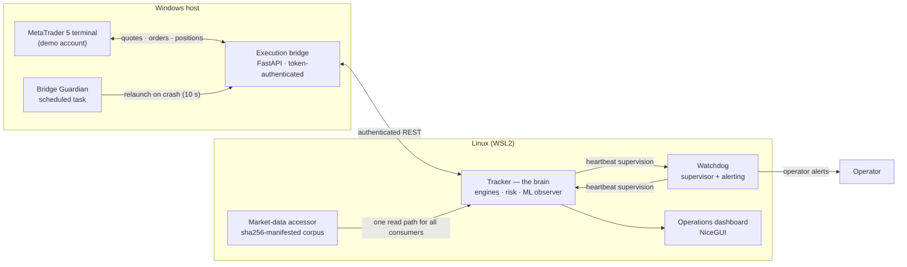

# Architecture

How the system is put together: the components, what each one is allowed to decide, and how the desk recovers when a piece of it fails.

## The shape of the system

Three layers, with a strict rule about who decides what: **the tracker decides, the bridge transports, the terminal executes.** No layer does another layer's job.

## Components

**Tracker (the brain).** A supervised service hosting the strategy engines, the risk layer, and the ML observer. It owns every trading decision: which registered arms are live, what the registry permits, when breakers halt the book. At startup it publishes a machine-readable **book manifest** — every arm loaded, every registry row skipped, and the gate that stopped each skip — so "what is the book right now" is a fact the system states, not something inferred from logs.

**Execution bridge.** A token-authenticated FastAPI service running on the Windows side, translating REST calls into MetaTrader 5 terminal operations: quotes, candles, positions, orders. It decides nothing. Authentication is file-only and fail-closed: the token lives in a single gitignored file, health is verified by a published fingerprint, and a missing or malformed token stops the import rather than letting the bridge run unauthenticated.

**MetaTrader 5 terminal.** The execution venue against a demo account. The bridge is broker-agnostic by design — any MT5 terminal can occupy this seat. The terminal autostarts at operator logon.

**Market-data layer.** One accessor over a stored corpus of 234 files (39 symbols × 6 timeframes, ~551 MiB, 2018–present), governed by a sha256 checksum manifest. Every consumer — engines, research pipeline, ML assembly — reads through the same door, in the broker's native instrument symbols. The accessor was proven equivalent to the parsers it replaced before cutover: a 148-capture oracle sweep across every served symbol, zero discrepancies, no fallback path kept.

**Watchdog.** An independent supervisor classifying the tracker's state from its heartbeat (live, starting, stuck, starved, dead) with criticals that are never cooldown-suppressed. It also runs the **registry-vs-manifest divergence check**: the live book is compared against the registry continuously, and any arm missing without an explained skip raises a critical alert — detection, logging, and alert delivery all proven by live drills, including a deliberately planted phantom row.

**Mutual supervision.** The tracker watches back. A dedicated thread — deliberately not on the trading loop, after a drill showed a loop-bound check could be starved by a blocked call — polls the watchdog's heartbeat and raises (and later clears) its own alert if the watchdog goes stale. Supervision now runs in both directions, and both directions have been drill-tested.

**Bridge Guardian.** A Windows scheduled task that probes the bridge's health endpoint and relaunches it within 10 seconds of a crash, with a crash-loop stop so a broken bridge cannot spin forever. Proven by a live kill drill. It never alerts — alerting is the watchdog's job alone, so a failure produces exactly one voice.

**Dashboard.** A locally served operations UI: positions, equity, per-arm state, breaker status. Local by design; it is an operator's window, not a public surface.

## Failure behaviour

- **A service crashes** → its supervisor restarts it; the book manifest at startup re-states the book; the registry fingerprint in the heartbeat proves the restart did not change what is seated.
- **The bridge dies** → the Guardian relaunches it; the tracker treats transport errors as transport errors (bounded retries, structured logging), never as phantom positions.
- **The host reboots** → Windows auto-restart is disarmed; at logon the terminal autostarts, the Guardian starts the bridge, and the linger-enabled services cold-start — a sequence proven clean after a real Windows-update reboot, with a full unattended logon drill scheduled as the remaining formal proof.
- **Anything unexplained** → the divergence check pages the operator. Explained states are logged; unexplained states are alarms. That asymmetry is the design.
